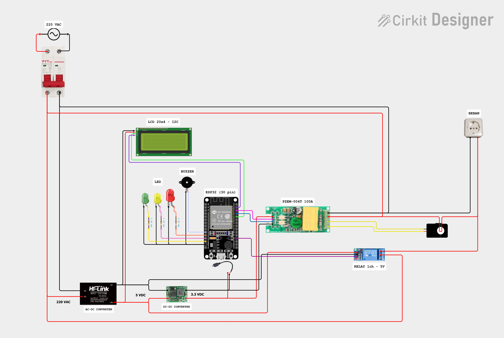
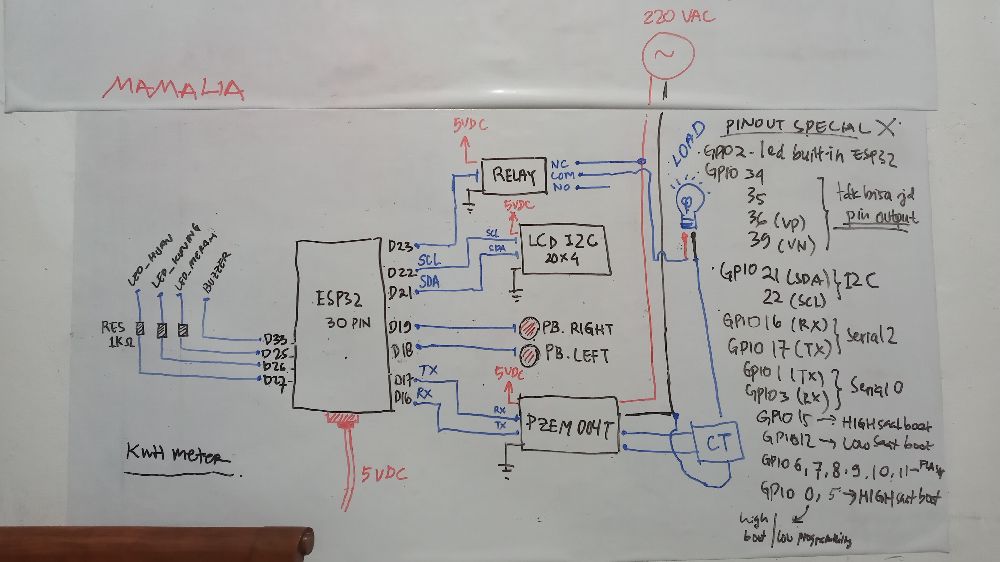
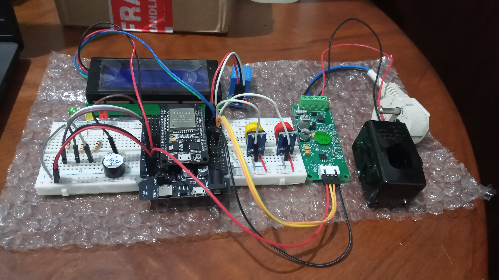
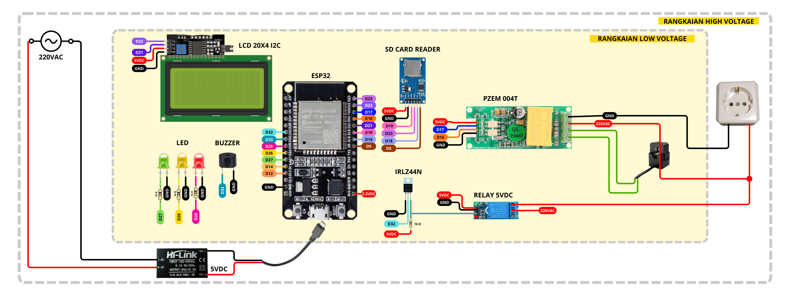
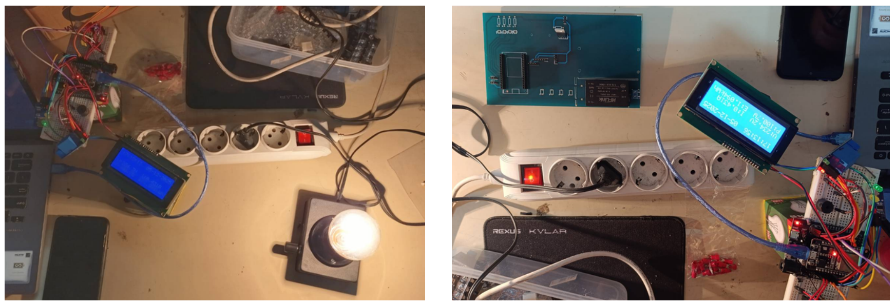

# EMBEDDED SYSTEM: OTOMASI KWH METER

Dokumentasi mencakup beberapa tahap pengembangan dam tidak dimaksudkan sebagai representasi keseluruhan implementasi final proyek.

## Tujuan Proyek

- Memantau besaran listrik AC (tegangan, arus, daya, energi, frekuensi, dan power factor) secara langsung.
- Memberikan indikasi kondisi beban melalui tampilan LCD, LED, dan buzzer.
- Melindungi beban dengan memutus aliran listrik secara otomatis saat kondisi kritis.
- Menyediakan waktu dan tanggal real-time melalui jaringan WiFi.
- Menyiapkan penyimpanan data pengukuran ke SD card.

## Komponen dan Integrasi 

| Komponen | Koneksi ke ESP32 lewat | Fungsi |
|---|---|---|
| ESP32 (30 pin) | - | Mikrokontroler utama |
| PZEM-004T | UART (Serial2) | Modul pengukuran parameter kelistrikan |
| LCD 20x4 I2C | I2C | Media visualisasi informasi dan hasil pengukuran |
| Relay 5VDC | GPIO | Komponen switching untuk pengendalian koneksi beban listrik |
| LED | GPIO | Indikator visual kondisi operasional sistem |
| Push Button | GPIO | Navigasi halaman tampilan |
| Buzzer | GPIO | Indikator audio untuk kondisi tertentu |
| SD Card Reader | SPI | Media penyimpanan data pengukuran |
| IRLZ44N | GPIO | Mosfet switch ESP32 - relay |
| Hi-Link (220VAC - 5VDC) | - | Konverter AC-DC untuk suplai daya sistem |
| Server NTP | WiFi | Sumber waktu dan tanggal

Alur kerja singkatnya: sensor PZEM mengukur beban, ESP32 membaca dan menilai hasilnya terhadap batas aman, lalu hasilnya ditampilkan di LCD dan menentukan kondisi LED, buzzer, dan relay.

## Dokumentasi Pengembangan

### 1. Skematik Awal

Rancangan awal (skematik kasar).

### 2. Rangkaian Awal

Dokumentasi tahap awal perakitan embedded system, ketika beberapa komponen mulai dihubungkan dengan ESP32 untuk mengevaluasi integrasi dan fungsi dasarnya.

> (konfigurasi koneksi dan pemetaan pin masih bersifat sementara serta mengalami penyesuaian selama proses pengembangan)

### 3. Rangkaian Progress

Dokumentasi perkembangan integrasi hardware pada tahap pengembangan berikutnya, sekitar 50–70% dari keseluruhan progres implementasi.

Tahap ini memperlihatkan susunan komponen yang lebih berkembang dibandingkan integrasi awal, meskipun belum merepresentasikan keseluruhan konfigurasi dan implementasi final saat pameran proyek.

## Ruang Lingkup Kontribusi

Dokumentasi ini berfokus pada kontribusi dalam perancangan dan pengembangan embedded system, berupa:

- Perancangan awal dan integrasi rangkaian hardware.
- Pemilihan serta pengujian komponen elektronik.
- Pengembangan kode mikrokontroler untuk kebutuhan integrasi perangkat.
- Implementasi dan penyesuaian konektivitas antarkomponen selama proses pengembangan.

> Repositori ini hanya memuat sebagian dokumentasi dan implementasi yang relevan dengan ruang lingkup kontribusi tersebut, bukan keseluruhan aset maupun hasil akhir proyek capstone.
