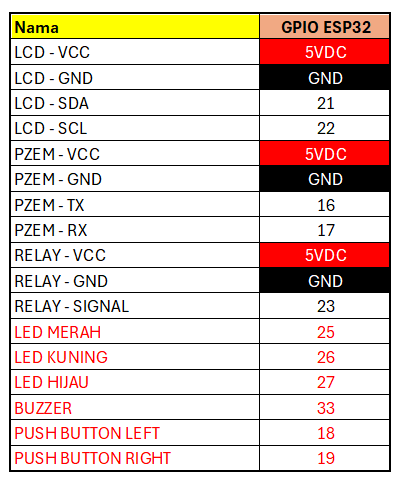
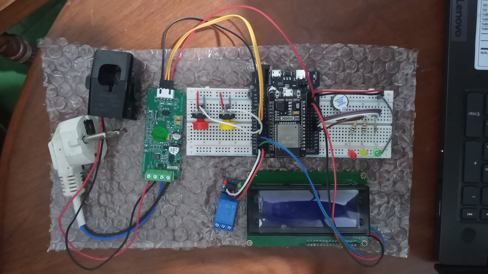

# OTOMASI KWH METERING
**Komponen:**
1. ESP32 (30 pin)       -- 1 pcs
2. LCD 20X4 I2C         -- 1 pcs
3. PZEM 004T            -- 1 pcs
4. Push button tactile  -- 2 pcs
5. LED R/G/Y            -- 1 pcs/warna
6. Buzzer 5V            -- 1 pcs
7. RELAY 5V             -- 1 pcs

 

**Konfigurasi GPIO ESP32** (sementara):  

 

**Rangakaian Sistem** (sementara):  

## **1. kwh_metering**
Kode untuk pengujian PZEM-004T dengan ESP32
